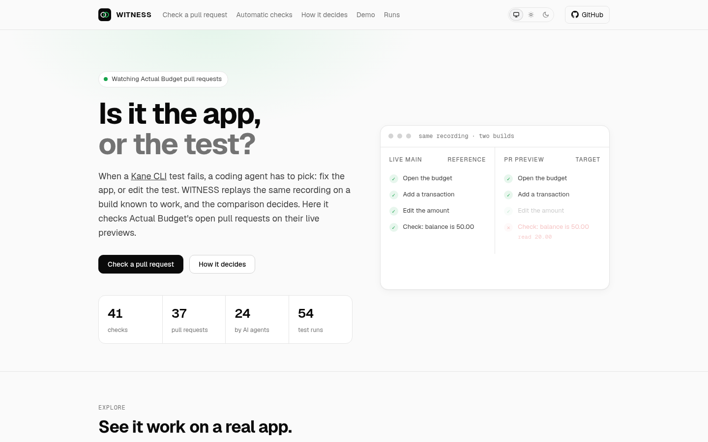
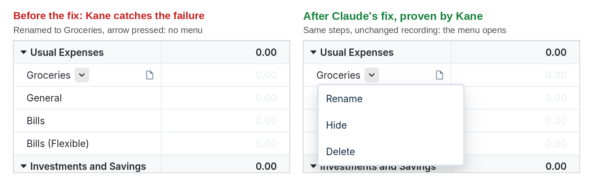

<div align="center">

# WITNESS

**When a Kane CLI test fails, your coding agent asks one question: is the app broken, or the test?<br>If it gets the wrong answer, it rewrites the test and the bug ships. WITNESS gives it the right answer, with proof.**

[**Live site**](https://witness-kane.vercel.app) · [Check a pull request](https://witness-kane.vercel.app/check) · [`npx kane-witness demo`](https://www.npmjs.com/package/kane-witness) · [For judges](#judges-one-minute-per-score)

[](https://github.com/Jennycruzy/witness/actions/workflows/ci.yml) [](https://www.npmjs.com/package/kane-witness)

<a href="https://witness-kane.vercel.app"></a>

</div>

## Three real bugs, fixed from Actual Budget's own source

[Actual Budget](https://github.com/actualbudget/actual) has 30,000 stars, and people keep their own money in it. For three real bugs, each fixed by a merged pull request, we built Actual from its own source at the commit **just before** the maintainers' fix, ran the Kane test, and let WITNESS and an agent take it from there (kane-cli 0.10.9, 26 November 2026).

<p align="center"></p>

| Real bug | Kane's label on the broken build | WITNESS | The agent's fix (one round each) | The maintainers' fix |
|---|---|---|---|---|
| [#8760](https://github.com/actualbudget/actual/issues/8760) A category's menu stops opening after a rename | **the test**: `automation_bug` 0.96, 0.98 | APP_BUG | [`useRefEventListener.ts`](evidence/actual-8760-fix/agent.patch) +29 −4 | [#8763](https://github.com/actualbudget/actual/pull/8763): same file, same design |
| [#8498](https://github.com/actualbudget/actual/issues/8498) A rule with a category group condition never matches | **the test**: `automation_bug` 0.94 to 0.98, in all 4 runs | APP_BUG | [`transaction-rules.ts`](evidence/actual-8587-fix/agent.patch) +6 | [#8587](https://github.com/actualbudget/actual/pull/8587): same file |
| [#9359](https://github.com/actualbudget/actual/issues/9359) The search is dropped after toggling reconciled rows | the app: `application_issue` 0.98 | APP_BUG | [`Account.tsx`](evidence/actual-9360-fix/agent.patch) +10 −12 | [#9360](https://github.com/actualbudget/actual/pull/9360): same file |

- **Kane blamed the test in 6 of the 8 failing runs** on these three bugs. An agent that trusts that label edits the test, the test goes green, and the bug reaches people's budgets. WITNESS replayed the same recording on the next nightly, where it passes, and said APP_BUG all 8 times.
- **The agent got only WITNESS's card**, Claude Code with read and edit tools, allowed to change only the app's source. All three fixes landed in the file the maintainers changed. On #8760 it also chose their design: find the element again after every render, rebind only when it moved, clean up on unmount in an effect of its own. The maintainers also added tests, and on #8760 fixed two more hooks with the same hidden bug; the agent was told not to touch tests.
- **Kane proved each fix.** WITNESS rebuilt Actual from the edited source, and the **unchanged** recording (same sha256) passed.
- **The guard held.** On the first try at #8498 we had allowed edits only in the UI package. The agent's fix was in the rules engine (`loot-core`), so WITNESS rolled it back and rejected the round ([kept here](evidence/actual-8587-fix/first-try-rejected/)). With `packages/` allowed, the same fix passed.
- **It works with the agent you already use.** A fresh Claude Code session with Kane's own skill and the WITNESS Stop hook (`witness install-hook`) fixed #8760 again, in the same file. When it tried to stop, the hook rebuilt Actual and replayed the pinned recording, the same sha256 as above. Kane passed it, and only then could the agent finish: [`PROVEN.md`](evidence/actual-8760-hook/PROVEN.md), [the hook's own record](evidence/actual-8760-hook/stop-hook.json), [the session](evidence/actual-8760-hook/session.ndjson).
- **Two more were not started, by design.** On #8725 the next nightly failed the test too (ENV), and on #9167 our source build failed at a click (TEST_PROBLEM). WITNESS starts a fix only on APP_BUG.

Every run, card, agent output and both diffs per bug: [`evidence/actual-8760-fix/`](evidence/actual-8760-fix/), [`actual-8587-fix/`](evidence/actual-8587-fix/), [`actual-9360-fix/`](evidence/actual-9360-fix/). The same three bugs had already been found by [`witness mine`](#what-it-found-on-real-software) from their issue text alone.

Kane's label is not stable even on one bug, one page and one port: in six more replays of #8760 it said the app once (0.91) and the test five times (0.93 to 0.98), even after WITNESS marked the bug real in Kane's bug memory ([runs](evidence/kane-cli-241-followup/)).

## What WITNESS has done

- **The Kane team fixed three Kane CLI bugs we found.** [#232](https://github.com/LambdaTest/kane-cli/issues/232): Kane labelled real app bugs as test bugs, so agents fixed the wrong thing. [#233](https://github.com/LambdaTest/kane-cli/issues/233): a list check passed on a blank todo. [#241](https://github.com/LambdaTest/kane-cli/issues/241): bug memory repeated a root cause marked wrong. All three were reproduced by the Kane team and closed as fixed.
- **It plugs in where agents and teams already work.** An npm package (`npx kane-witness`), a [GitHub Action](#on-every-pull-request-the-github-action) that commented APP_BUG and the agent's card on a real pull request ([#2](https://github.com/Jennycruzy/witness/pull/2#issuecomment-7191732394)), a Claude Code skill, and a Stop hook that would not let a fresh agent finish Actual #8760 until Kane passed the unchanged recording ([proof](evidence/actual-8760-hook/PROVEN.md)).
- **On the newest Kane, it is still not enough.** On 28 real app bugs, with the answers committed before the first run, kane-cli 0.10.9 told the agent to edit the test 5 times. WITNESS: **0**. ([Triage bench](#triage-bench-43-cases-answers-fixed-before-any-run))
- **It runs on a real app that people keep their money in.** [Actual Budget](https://github.com/actualbudget/actual) has 30,000 stars, and AI agents write most of its changes: 24 of its 36 open pull requests are marked `[AI]`. WITNESS has checked 40 of them on their live previews. It blamed none of them for a bug they did not add.
- **Real bugs in five open-source apps, web and desktop:** Actual Budget, CyberChef, IT-Tools, TodoMVC and MarkText. Each one has its test, both builds and every Kane run in this repo.
- **It catches a bug that a clean test run cannot see.** In Actual Budget [#6574](https://github.com/actualbudget/actual/issues/6574), a budget saved by an older version will not open after the update. A fresh browser passes, so plain Kane misses it. WITNESS replays with the saved data and names it.

## Why Kane's label is not enough

When a Kane test fails, a coding agent has to choose: fix the app, or fix the test. Kane gives a label for that, and agents act on it. #8760 is not rare. On 12 real app bugs in four open-source apps (CyberChef, IT-Tools, Actual Budget, TodoMVC), Kane's label pointed at the test in 6. On a 13th, Kane passed the bug outright.

## How WITNESS decides

It replays the **same recording** on a reference build that is believed to work (the app's live main build for a pull request, the last release, yesterday's nightly) and decides by comparison, not by Kane's label:

| Reference | Your build | Verdict | What the agent is told |
|---|---|---|---|
| passes | fails **at a check** | **APP_BUG** | Fix the app, not the test |
| passes | fails at a click or typing step | **TEST_PROBLEM** | The page changed where the test acts: re-record it |
| fails too | fails | **ENV** | Check the environment before changing anything |
| passes, and the branch is behind it | fails at a check, and so does the published build from before the branch split off | **BEHIND_MAIN** | The bug is older than this pull request: update the branch from main |
| — | passes, but a check read hidden text | **BLIND** | That step cannot see the bug it should catch: harden it |
| passes with the data it saved | passes in a clean browser, fails **only with the data the reference saved** (`--carry-state`) | **STATE_BUG** | Fix the app so it opens data saved by the earlier build: do not edit the test or clear the data |

Then Kane proves the fix: the **unchanged** recording (same sha256) must pass on the rebuilt app.

## Pull request checks on Actual Budget

[Actual Budget](https://github.com/actualbudget/actual) is an open-source budgeting app that people use for their own money. Coding agents write a large share of its changes: 32 of its last 60 merged pull requests are marked `[AI]` (counted 25 November 2026). Every pull request gets a live preview of the app.

How a check works:

1. **Pick.** `witness pr watch` looks at the open pull requests every three hours and picks each new commit whose changed files touch an area a test covers (`areas` in [`pr.json`](examples/pr/actual/pr.json)).
2. **Replay on the preview.** Kane uses the pull request's live preview like a person would, replaying tests written from Actual's own bug reports. Each of those tests caught its real regression on Actual's own builds.
3. **Compare.** If a test fails, the same recording is replayed on Actual's live main build (`edge.actualbudget.org`). Fails only on the preview: the pull request added the bug (APP_BUG). Fails on main too: ENV. If the branch is behind main, the published nightly from the day it split off is replayed as well; if that fails too, the bug is older than the pull request (BEHIND_MAIN).
4. **Show.** The result appears on the [live site](https://witness-kane.vercel.app/checks) under *Checked automatically*, and every check is committed as one `pr.json` in [`examples/pr/actual/runs/`](examples/pr/actual/runs/).

**Results, 25 November 2026:** 40 checks of 36 open pull requests (24 marked `[AI]`), 50 test runs: 46 PASS, 2 BEHIND_MAIN, 1 TEST_PROBLEM, 1 ENV. No pull request was blamed for a bug it did not add.

- **The two BEHIND_MAIN verdicts.** [#8886](https://github.com/actualbudget/actual/pull/8886) (`[AI]`) failed the search test and [#9336](https://github.com/actualbudget/actual/pull/9336) the schedule test. Both branches split off main before the fix each test was written from ([#9360](https://github.com/actualbudget/actual/pull/9360), [#9173](https://github.com/actualbudget/actual/pull/9173)) was merged, and the nightlies from those days (26.11.0-nightly.20261023 and 20261028) fail the same tests. The first version of the watch called them APP_BUG; that is why BEHIND_MAIN exists ([#8886 run](examples/pr/actual/runs/pr-8886-2026-11-25T18-51-31-866Z/pr.json), [#9336 run](examples/pr/actual/runs/pr-9336-2026-11-25T18-59-28-261Z/pr.json)).
- **The TEST_PROBLEM and the ENV** both came from the first check of [#9640](https://github.com/actualbudget/actual/pull/9640), which used recordings made on August nightlies. The amount filter failed at a typing step on the preview, and the category-group rule failed at its first click on main as well. Neither verdict blamed the pull request. The rule test was recorded again on main (passes 3 of 3 replays there); the amount filter test is no longer used for pull requests.

Run one yourself:

```bash
witness pr list  examples/pr/actual/pr.json          # open pull requests with a live preview, [AI] marked
witness pr check examples/pr/actual/pr.json 9662     # one pull request, its tests, its verdict
witness pr watch examples/pr/actual/pr.json --plan   # what the next automatic run would check
```

## What it found on real software

All of it is real: public bugs in real apps, real Kane runs (kane-cli 0.10.5, 17 to 19 November 2026). Nothing is planted. `witness verify` recomputes every number below from the runs committed in [`evidence/`](evidence/) and checks their sha256.

| | Kane's own label | WITNESS |
|---|---|---|
| Real app bugs (12) | right on **6 of 12** | right on **12 of 12** |
| Real test problems (3) | right on 3 of 3 | right on **3 of 3** |
| Regressions found by `witness mine` (16; kane-cli 0.10.9, 24 November) | right on 15 of 16 | right on **16 of 16** |
| Real bug Kane passed (1) | PASS | flagged the check as **LOCKED** from the recording, before any run |

- **Three shipped regressions in well-known apps**, each a plain-English Kane test recorded once on the last good release and replayed on the release that broke it ([`examples/`](examples/)):
  - **IT-Tools** (41k stars), v2024.5.13 → v2024.10.22: the heart button on a tool's page no longer adds it to favourites ([#1365](https://github.com/CorentinTh/it-tools/issues/1365), still in the latest release). Kane labelled it `automation_bug` (0.96). WITNESS: APP_BUG.
  - **CyberChef** (36k stars), v10.22.1 → v10.23.0: JWT Sign and Verify fail with *"Right-hand side of 'instanceof' is not an object"* ([#2434](https://github.com/gchq/CyberChef/issues/2434), still in v11.5.0). Kane: `application_issue` (0.98). WITNESS: APP_BUG.
  - **Actual Budget**, shipped in 26.1.0, fixed in 26.2.0 (the reference): completed schedules stay shown every time the page is opened again ([#6606](https://github.com/actualbudget/actual/issues/6606)). Kane: `application_issue` (0.97). WITNESS: APP_BUG.
- **TodoMVC Svelte, [#2315](https://github.com/tastejs/todomvc/issues/2315) (open).** Kane failed the edit test and labelled it `automation_bug` (0.88). WITNESS: the same recording passes on the Vue build and fails here at a check, so APP_BUG. Claude Code got WITNESS's card, changed one line in `src/Item.svelte` ([diff](evidence/todomvc-svelte-trim.patch)), WITNESS rebuilt the app, and the unchanged recording passed 5 of 5 with no self-healing.
- **A check that could not see the bug.** In the same test, Kane's check *"the list shows exactly one todo, b"* passed on the buggy build in every run, reading `"\nb"`: the blank todo was on the page, and the comparison stripped it away. WITNESS flags this as BLIND.
- **Actual Budget, [#8475](https://github.com/actualbudget/actual/issues/8475).** The running balance stopped updating after an edit. The recording passes on the 17 June 2026 nightly and fails on 20 June at the balance check (reads 20.00, expected 50.00). That bug shipped to everyone in 26.7.0 on 2 July and was first reported on 14 July.
- **Six more open TodoMVC bugs** ([#2309](https://github.com/tastejs/todomvc/issues/2309) react, [#2310](https://github.com/tastejs/todomvc/issues/2310) es5, [#2311](https://github.com/tastejs/todomvc/issues/2311) es6, [#2313](https://github.com/tastejs/todomvc/issues/2313) lit, [#2314](https://github.com/tastejs/todomvc/issues/2314) web-components), each a plain-English Kane test recorded once on the Vue build and replayed on the buggy one. Kane labelled three of them `automation_bug` (0.78 to 0.98). WITNESS: APP_BUG on all.
- **A check locked to its own answer.** On javascript-es6 ([#2311](https://github.com/tastejs/todomvc/issues/2311)), Kane passed *"the first todo is a and the second is b"* while the list showed b, a. Its recording finds each todo *by the text it expects* and reads that text back, so it can never see the order. WITNESS flags this as LOCKED from the recording alone (free, no run). Given only WITNESS's message, Claude Code rewrote the step to *"the todo list reads, from top to bottom: a, b"*; re-recorded, it fails on es6 and passes on Vue.
- **A bug a clean test run cannot see: Actual Budget, [#6574](https://github.com/actualbudget/actual/issues/6574), still in the newest release (26.11.0).** One device on 25.11.0 imports a bank file; another device on the new version imports too, and the server now holds the old and the new name of the same setting. When the first browser updates, the budget will not open: `UNIQUE constraint failed: preferences.id`. Kane starts every run in a clean browser, so its replay on 26.11.0 **passes**. `witness guard --carry-state` plays that history first, on one fixed port, and carries the browser's saved data into the run: the same recording **fails at the check** on 26.11.0 (Kane: *"The app remained on the Files screen"*), passes on 25.11.0 with the data it saved, and passes on 26.11.0 in a clean browser. STATE_BUG ([runs](evidence/actual-6574-saved-state/), [setup](examples/actual-6574/), kane-cli 0.10.8, 23 November 2026).
- **Bugs found by machine: `witness mine`** ([`examples/mine/`](examples/mine/), kane-cli 0.10.9, 24 November 2026). It read 91 merged fixes that close an issue: 41 in CyberChef and 50 in Actual Budget. The test writer turned 34 issue reports into Kane tests (it never sees the fix) and said the other 57 had no single visible check. Each test was recorded on the first release with the fix and replayed on the release before it: **16 kept** (fixed passes, buggy fails at the check).
  - **CyberChef, 22 tests, 11 kept**, including [#1950](https://github.com/gchq/CyberChef/issues/1950) Parse IP range, [#2024](https://github.com/gchq/CyberChef/issues/2024) Extract email addresses, [#2246](https://github.com/gchq/CyberChef/issues/2246) To Modhex, [#2280](https://github.com/gchq/CyberChef/issues/2280) MIME decoding and [#2306](https://github.com/gchq/CyberChef/issues/2306) an unescaped value in the output; 2 TEST_PROBLEM (failed at a click on the old release), 1 missed (the old release passes too), 7 whose recording did not pass on its own fixed release, 1 undecided.
  - **Actual Budget, 12 tests, 5 kept**: [#8498](https://github.com/actualbudget/actual/issues/8498) rules with a category group condition never matched, [#8725](https://github.com/actualbudget/actual/issues/8725) the amount filter let the wrong sign through, [#8760](https://github.com/actualbudget/actual/issues/8760) category menus stopped opening after a rename, [#9167](https://github.com/actualbudget/actual/issues/9167) editing a schedule lost its skipped dates, [#9359](https://github.com/actualbudget/actual/issues/9359) the search dropped after toggling reconciled rows; 1 missed, 5 whose recording did not pass on its own fixed release, 1 undecided.
  - **MarkText, a desktop app** (Electron; kane-cli 0.10.9, 25 November 2026): 12 tests written from 53 fixes. Of the 4 replayed so far (about 75 Kane credits each), **2 kept**: [#5967](https://github.com/marktext/marktext/issues/5967) a backslash at the end of a line was taken as text instead of a line break (v0.23.0, fixed in v0.24.0-rc.1), and [#1691](https://github.com/marktext/marktext/issues/1691) ordered task lists were not handled to spec (v0.20.0-rc.7, fixed in v0.20.0). Kane's label was right on both. WITNESS starts each GitHub release of the app with a debugging port and hands it to Kane over CDP, so the same comparison runs on two builds of a desktop app. Two things the tests have to say for this app: type with single key presses (Kane's typing action replaces the whole editor's text), and MarkText's line-break arrow (↵) is not a backslash. The other 2 recordings did not pass on their own fixed release.
  - Kane's label was right on 15 of the 16 kept. It named the app on every one-operation bug; the one it got wrong is the multi-step menu case (#8760), which it called an automation bug at 0.95. Every case keeps its test, both builds, the runs and `result.json`; `witness mine summary` recounts them.
- **Actual Budget, a layout change between 26.8.0 and 26.7.0.** The replay failed at a click: TEST_PROBLEM. Re-recording on 26.7.0 passed the click, then failed at the balance check: the real #8475 bug, now an APP_BUG.

## Triage bench: 43 cases, answers fixed before any run

[`bench/`](bench/): 28 real app bugs, 2 real test problems and 13 controls, each a Kane test and two real builds. The answers and the held-out half were committed (sha256) before the first run.

| kane-cli | Kane's label right | WITNESS right | Real app bugs where the agent is told to edit the test: Kane / WITNESS |
|---|---|---|---|
| 0.10.5 | 32 of 43 | **37 of 43** | 8 / **0** of 28 |
| 0.10.8 | 36 of 43 | 36 of 43 | 5 / **1** of 28 |
| 0.10.9 | 36 of 43 | **38 of 43** | 5 / **0** of 28 |

A watcher on our server checks npm every hour and runs the whole bench on each new kane-cli release, so this table grows with Kane.

Most of WITNESS's misses are ENV (the reference failed too on the bench machine, so nobody is told to change anything); each miss is explained in [`bench/README.md`](bench/README.md#results-25-november-2026).

## Reported upstream

| Where | What we sent | Outcome |
|---|---|---|
| Kane CLI [#232](https://github.com/LambdaTest/kane-cli/issues/232) | Replay triage labels real app bugs `automation_bug`, so agents fix the test instead of the app | **Reproduced and fixed by the Kane team** (3 of 3 runs wrong before, 4 of 4 right after); closed as fixed in kane-cli 0.10.8. Our recordings already flip on 0.10.7: [below](#kane-cli-0107-on-our-recordings) |
| Kane CLI [#233](https://github.com/LambdaTest/kane-cli/issues/233) | A list check passes on a blank todo because the comparison strips the blank line | **Reproduced and fixed by the Kane team**: list checks are now recorded item by item, so the blank todo fails the check; closed as fixed in kane-cli 0.10.8 |
| Kane CLI [#241](https://github.com/LambdaTest/kane-cli/issues/241) | Kane's bug memory recalls a bug marked real and rca-wrong with a note, then repeats the root cause marked wrong ([repro pack](evidence/kane-cli-241/)) | **Reproduced by the Kane team**, all four causes confirmed: the note was cut at 120 characters, the wrong root cause was still shown as fact, recall matched the exact page including the port, and the diagnosis saw only the failing step. Fix in progress: recall by similarity, full notes, wrong root causes labelled as wrong, earlier steps given to the diagnosis. A short note (112 characters, all inside the limit) is recalled and still not used on 0.10.8 (runs 6 and 7 in the pack). **Closed as fixed in kane-cli 0.10.9.** Re-run on 0.10.9 (25 November, [run 8](evidence/kane-cli-241/)): Kane now reads the note, and answers it: *"This run's screenshot therefore contradicts BUG-5's last note that this is a real app bug"*, `automation_bug` 0.91. The screenshot shows the blank todo and "2 items left": the app bug. WITNESS: APP_BUG (the Vue build passes). `witness guard --teach` writes these marks and a short note for every verdict. A follow-up from Actual Budget on 0.10.9 is [posted on the issue](https://github.com/LambdaTest/kane-cli/issues/241#issuecomment-7189715783) |
| Kane CLI [#244](https://github.com/LambdaTest/kane-cli/pull/244) | A change to Kane's own agent skill (`bugs.md`, `debug.md`, `testmd.md`): when it is unclear whether the product or the test is wrong, replay the same saved test, unchanged, on a build known to work, and decide by that | Open. The bench numbers and the three Actual Budget results are [posted on the pull request](https://github.com/LambdaTest/kane-cli/pull/244#issuecomment-7189715339) |
| TodoMVC [#2320](https://github.com/tastejs/todomvc/pull/2320) | Svelte fix for [#2315](https://github.com/tastejs/todomvc/issues/2315): trim edited todos, restore the filter on reload | The fixed build passes both Kane tests, and all 36 rules of TodoMVC's app spec in a Playwright check |

### kane-cli 0.10.7 on our recordings

The same recordings from #232, replayed without self-healing on 0.10.5 and on 0.10.7 (20 November 2026). Every run is in [`evidence/kane-cli-232/`](evidence/kane-cli-232/).

| Real app bug | Kane 0.10.5 label | Kane 0.10.7 label | WITNESS |
|---|---|---|---|
| TodoMVC Svelte [#2315](https://github.com/tastejs/todomvc/issues/2315), edit test | `automation_bug` 0.88, 0.93 | **`application_issue` 0.98, 0.99** | APP_BUG |
| Actual Budget [#6794](https://github.com/actualbudget/actual/issues/6794), 1'234.56 saved as 1.00 | `automation_bug` 0.87 | `application_issue` 0.96 in one run, `automation_bug` 0.96 in the other, same path | APP_BUG |

The fix works on the TodoMVC case. On Actual Budget the recorded check is `match(/1'234\.56/) || null`: on the buggy build it reads `None`, not `1.00`, so Kane's triage cannot see the wrong value. That is a LOCKED check, and WITNESS flags it from the recording. WITNESS's verdict does not depend on Kane's label: the same recording passes on 26.2.0 and fails on 26.1.0, so APP_BUG on either Kane version. We sent these results back on [#232](https://github.com/LambdaTest/kane-cli/issues/232#issuecomment-7046401902).

## Install

Needs Node 20+, Google Chrome, and a [Kane CLI](https://www.testmuai.com/kane-cli/) login (`npm i -g @testmuai/kane-cli && kane-cli login`). The `witness pr` commands also read pull requests through the [GitHub CLI](https://cli.github.com/) (`gh auth login`).

```bash
git clone https://github.com/Jennycruzy/witness && cd witness
npm ci && npm run build && npm link     # gives you the `witness` command
```

Then, in your app's folder:

```bash
witness init      # finds your Kane tests and build, writes witness.json, installs the pinned Stop hook
witness guard     # replays the tests; on a failure, the reference build decides
```

`witness init` takes the reference from `origin/main` (built in its own worktree) unless you pass `--reference <staging url>` or `--npm <package>` for the last release. It prints everything it guessed, and never replaces an existing `witness.json` without `--force`.

### On every pull request: the GitHub Action

```yaml
# .github/workflows/witness.yml: build your app twice (the PR and the base branch), then
- uses: Jennycruzy/witness@master
  with:
    working-directory: e2e            # holds witness.json and the Kane tests
    kane-username: ${{ secrets.KANE_USERNAME }}
    kane-access-key: ${{ secrets.KANE_ACCESS_KEY }}
```

It installs Kane CLI and `kane-witness` from npm, runs every test on the PR's build, and replays a failing one on the base build. Then it posts the verdict and the agent's card on the pull request, and sets the `verdict` output (`PASS`, `APP_BUG`, `TEST_PROBLEM`, `ENV`, …). The job needs `pull-requests: write` to comment. This repository's own [pull request check](.github/workflows/pr-check.yml) uses it. On [pull request #2](https://github.com/Jennycruzy/witness/pull/2), which puts back the upstream TodoMVC Svelte code with the two bugs from [#2315](https://github.com/tastejs/todomvc/issues/2315), both tests failed on the PR's build and passed on the base build, and the action [commented APP_BUG with the card](https://github.com/Jennycruzy/witness/pull/2#issuecomment-7191732394) (Kane's labels 0.94 and 0.98). An [earlier run](https://github.com/Jennycruzy/witness/actions/runs/45804388751) on the commit before the fix gave the same verdicts.

## Check it yourself in 60 seconds (no login)

```bash
npx -y kane-witness demo
```

One real case from start to finish (Kane's label, the second build, the card, the agent's one-line fix, the unchanged recording passing), then every number above recomputed from the committed runs. No Kane login, no credits, no network calls of its own. Or from a clone:

```bash
git clone https://github.com/Jennycruzy/witness && cd witness
npm ci && npm run build
npm test                    # unit tests on the real runs
node dist/cli.js demo       # the walk-through above
node dist/cli.js verify     # recomputes every number above from evidence/, checks sha256
```

## Judges: one minute per score

| Score | Look at | What you see |
|---|---|---|
| Ships | `npx -y kane-witness demo` | The full flow on a real bug, from the real Kane runs, in under a second after install |
| Ships | [`examples/actual`](examples/actual) and [`evidence/actual-8475-search.json`](evidence/actual-8475-search.json) | The nightly watch set up on Actual Budget, and the build search that found the first bad nightly for #8475 (20 June 2026) unattended, with the commits in between |
| Verified | `node dist/cli.js verify` | Kane's label right on 6 of 12 real app bugs in four apps, WITNESS 12 of 12; 3 of 3 real test problems; the 16 mined regressions (Kane 15 of 16, WITNESS 16 of 16); ENV where the good build fails too; every evidence file checked by sha256 |
| Verified | [Reported upstream](#reported-upstream) | Three Kane CLI issues reproduced and fixed by the Kane team; the TodoMVC fix PR |
| Closed loop | [Three real bugs](#three-real-bugs-fixed-from-actual-budgets-own-source) | Actual Budget built from its own source at the commit before each fix: Kane blamed the test in 6 of 8 failing runs, WITNESS said APP_BUG in all 8, Claude Code fixed all three in one round each, in the maintainers' file, and the unchanged recordings passed |
| Verified | [`evidence/actual-6574-saved-state/`](evidence/actual-6574-saved-state/) and its row in `verify` | A live Actual Budget bug that a clean Kane run passes on the newest release; with the browser data the previous release saved, the same recording fails: STATE_BUG |
| Closed loop | [`evidence/todomvc-svelte-trim-hook-untold.patch`](evidence/todomvc-svelte-trim-hook-untold.patch) and its row in `verify` | A Claude Code session told about one bug tried to stop; the Stop hook blocked it on a second bug it was never told about; it fixed that too, and the unchanged recordings passed |
| Closed loop | [Pull request #1](https://github.com/Jennycruzy/witness/pull/1) | On GitHub: a PR puts back the upstream TodoMVC Svelte code; the check replays the Kane tests on the PR's build and the base build and comments APP_BUG with the card; a separate Claude Code agent given only that comment fixes two app files; the check goes green |
| Closed loop | [`evidence/actual-8760-hook/`](evidence/actual-8760-hook/) and its row in `verify` | A fresh Claude Code session with Kane's own skill and the WITNESS Stop hook fixes Actual #8760; the hook rebuilds Actual and replays the pinned recording (same sha256 as the earlier proof) before the agent may stop: Kane PASSED, `PROVEN.md` written |
| Closed loop | [`src/commands/fix.ts`](src/commands/fix.ts) | Agent edits outside the app source are rolled back; a changed test or recording (sha256) is rejected |
| Closed loop | [`evidence/skill-fresh-session/`](evidence/skill-fresh-session/) and its row in `verify` | A fresh Claude Code session with only the WITNESS skill, asked "The Kane test fails on this TodoMVC app. Sort it out.", loaded the skill by itself; Kane said `automation_bug` 0.9, WITNESS said APP_BUG, the agent wrote *"I didn't go by that label"*, fixed the app only, and the re-run passed |
| Verified | [`bench/`](bench/) and `witness bench score bench/cases.json` | 43 cases with answers fixed before any run, on kane-cli 0.10.5, 0.10.8 and 0.10.9: how often Kane's label and WITNESS tell an agent to edit the test when the app is broken |
| Ships | [witness-kane.vercel.app/check](https://witness-kane.vercel.app/check) | Pick any open pull request of Actual Budget and watch Kane check its live preview, then the verdict; below it, the TodoMVC upstream build or the fixed build. The same page runs locally with `witness live examples/todomvc-svelte/live.json` |
| Ships | [`action.yml`](action.yml) and [pull request #2](https://github.com/Jennycruzy/witness/pull/2#issuecomment-7191732394) | The GitHub Action from npm `kane-witness` on a real pull request: both tests fail on the PR's build and pass on the base build, and the action comments APP_BUG with the agent's card |
| Ships | [`examples/pr/actual/runs/`](examples/pr/actual/runs/) | 40 checks of 36 open Actual Budget pull requests (25 November), one `pr.json` per check |
| Craft | [How I tried to break it](#how-i-tried-to-break-it) | Each way the verdict could be wrong, and the run or test that covers it |

## How I tried to break it

| Attack | What WITNESS does | Covered by |
|---|---|---|
| Kane's label blames the test for a real app bug | Ignores the label; the second build decides | 6 of 12 real app bugs in `verify` |
| Kane self-heals past a bug | Replays with `--no-adaptive-heal`; a fix proof with any heal does not count | [`src/io/kane.ts`](src/io/kane.ts), fix rows in `verify` |
| Kane records steps again instead of replaying (stale recording) | Verdict STALE; a fix proof must replay every step | [`test/classify.test.ts`](test/classify.test.ts) "stale recording" |
| A check passes while reading a blank line it strips (`"\nb"`) | BLIND | [`test/blind.test.ts`](test/blind.test.ts), 2 real runs in `verify` |
| A check finds the item by the text it expects, so it cannot fail | LOCKED, from the recording alone, before any run | [`test/locked.test.ts`](test/locked.test.ts), es6 #2311 in `verify` |
| A check's code can only read back its expected value (`match(/expected/) \|\| null`), so a wrong value reads as `None` | LOCKED, from the recording alone, before any run | [`test/locked.test.ts`](test/locked.test.ts), the real Actual Budget #6794 recording |
| Kane recorded a check with an expected value but no code to read the page (it judged by eye while recording) | LOOSE, from the recording alone: a replay cannot check that step | [`test/guard.test.ts`](test/guard.test.ts) "loose checks", on a real TodoMVC recording |
| A fresh recording does not replay even on the build it was made on | `record` replays it once there before keeping it; if it fails: UNSTABLE, with the step and Kane's reason | [`test/guard.test.ts`](test/guard.test.ts) |
| There is no recording, so a run would quietly record (and bill) instead of replaying | NO_RECORDING: nothing runs and nothing is spent unless `--record-missing` is given | [`test/guard.test.ts`](test/guard.test.ts) |
| The test cannot pass anywhere (Kane recorded a JWT Sign check with the token's own timestamp in its locator) | ENV on both builds: nobody is told to change the app | CyberChef row in `verify` |
| The reference build is broken too | ENV: nobody is told to change anything | [`test/classify.test.ts`](test/classify.test.ts) "reference build broken too" |
| The bug only shows with data an older build saved, and Kane starts every run in a clean browser | `--carry-state`: the user's history runs first on the builds it names, on one port (browser storage belongs to an origin); the target runs with that saved data and in a clean browser; the reference runs with the data it saved itself, copied before a newer build could change it; every target attempt (retry and clean run included) starts on its own copy of the saved data, and each `guard` run replays the history into a new folder, so a CI retry never sees an earlier attempt's writes. STATE_BUG only when the saved data alone makes the difference | [`test/carry.test.ts`](test/carry.test.ts), Actual #6574 row in `verify` |
| The page layout changed where the test clicks | TEST_PROBLEM, not APP_BUG | 3 real test problems in `verify` |
| The agent edits the test or its recording to make it pass | Rejected: recording sha256 must not change | [`src/commands/fix.ts`](src/commands/fix.ts) |
| The agent edits files outside the app source | Rolled back and rejected | [`src/commands/fix.ts`](src/commands/fix.ts) |
| With the Stop hook, the agent edits the test or its recording | The tests and recordings are pinned (sha256) outside the project when the hook is installed; the hook blocks the stop until they are put back | [`test/hook.test.ts`](test/hook.test.ts) |
| The agent changes folder before it stops, so the hook starts somewhere else | The hook finds `witness.json` from Claude Code's project folder, or the nearest folder up | [`test/hook.test.ts`](test/hook.test.ts), the Actual #8760 hook run |
| The check itself breaks (a build or setup error) | Fails closed: the agent cannot stop on a fix WITNESS could not check; the same failure three times hands it to a person | [`test/hook.test.ts`](test/hook.test.ts) |
| The build given to `witness search` as good has the bug too, so any window it names is wrong (this happened on Actual Budget #9359: 2 September was given as good and fails as well) | `witness search` replays both ends first and stops with GOOD_FAILS or BAD_PASSES | [`test/search.test.ts`](test/search.test.ts) |
| A click fails because the machine is busy | `witness search` replays that build once more before deciding | [`src/commands/search.ts`](src/commands/search.ts) |
| Someone edits the evidence | `verify` fails on any sha256 change | [`evidence/manifest.json`](evidence/manifest.json) |

## Use it

Put a `witness.json` next to your Kane tests:

```json
{
  "tests": ["tests/edit_trim_test.md"],
  "target":    { "dir": "dist" },
  "reference": { "url": "https://staging.example.com/" },
  "fix": { "agent": ["claude", "-p", "--allowedTools", "Read,Edit"], "cwd": ".", "source": "src", "build": "npm run build" }
}
```

| Command | What it does | Kane credits |
|---|---|---|
| `witness init` | Writes `witness.json` for the project (Kane tests, build command, output folder, `origin/main` or `--reference`/`--npm` as the reference) and installs the pinned Stop hook (`--no-hook` to skip) | 0 |
| `witness record <test>` | Records the test's steps with Kane on the reference build (with an npm channel: the newest release) and keeps the recording | ~50 for a short test |
| `witness demo` | One real case end to end and every number recomputed, from the committed runs; no login | 0 |
| `witness guard` | Runs each test on your build; on a failure replays it on the reference and gives the verdict | 0 when the target passes; about 2 per failing test (Kane's triage); the reference replay 0 |
| `witness fix <test>` | APP_BUG → the agent gets the card (it may change only `source/`) → rebuild → the unchanged recording must pass | rebuild + replays |
| `witness install-hook` | Adds a Claude Code Stop hook and pins every Kane test and its recording (sha256, kept outside the project). Before the agent may stop, the hook rebuilds the app and replays the pinned recordings: it blocks on an open verdict, on a changed test or recording, and on any run it could not check. When all pass it writes `.witness/PROVEN.md` | One replay per test each time the agent stops (a few credits) |
| `witness pin [witness.json]` | A person accepts the tests and recordings as they are now, after changing a test on purpose | — |
| `witness install-skill [--global]` | Adds the [Claude Code skill](skills/witness/SKILL.md): when a Kane test fails, the agent runs `witness guard` and acts on the verdict, not on Kane's label | — |
| `witness guard … --only <test>` | Checks one test | as `guard` |
| `witness guard … --carry-state` | Also checks each test with the browser data earlier builds saved (`carryState` below); works in `record`, `fix` and `install-hook` too | as `guard`, plus the clean and reference replays |
| `witness guard … --teach` | After each verdict, writes it into Kane's bug memory: marks the bug Kane filed for that run real or not, its root cause right or wrong, and adds one note under Kane's 120-character limit. It never closes a bug: that stays a person's call | 0 |
| `witness teach <run folder> <test>` | The same for a run that already has a verdict | 0 |
| `witness mine plan <mine.json>` | Lists an app's merged pull requests that close an issue, picks the published build before and after each fix (npm nightlies or GitHub releases), and has an agent write a Kane test from the **issue text alone** (it never sees the fix). Reports it cannot turn into one visible check are marked not testable | 0 |
| `witness mine run <mine.json>` | Records each test on the fixed build, checks the recording replays there, then replays it on the buggy build. A case is kept only when the fixed build passes and the buggy one fails at a check | ~50 per recording, then as `guard` |
| `witness guard … --record-missing` | Records a test once on the reference when it has no recording here, or Kane cannot replay it | ~50 per test recorded |
| `witness pr list <pr.json>` | Lists an app's open pull requests that have a live preview (found in the pull request's GitHub statuses), and marks the ones written by a coding agent | 0 |
| `witness pr check <pr.json> <n>` | Kane replays the app's saved tests on pull request n's live preview; a failing test is replayed on the app's live main build, so the verdict says whether this pull request added the bug. Example: [`examples/pr/actual/`](examples/pr/actual/) (Actual Budget previews against `edge.actualbudget.org`) | 0 when the preview passes; as `guard` on a failure |
| `witness pr watch <pr.json>` | Checks every open pull request whose newest commit has not been checked yet, with only the tests for the areas it changes (`areas` in `pr.json`); `--plan` lists those checks without running them. On the hosted page it runs every three hours and each check is listed under *Checked automatically* | as `pr check`, per pull request |
| `witness live <live.json>` | Serves the Run it live page: one run at a time, a cap on runs per hour and per visitor | as `guard`, per click |
| `witness search <test> <good> <bad>` | Replays the test across published builds to find the first bad one, then lists the commits in between | ~5 per failing build |
| `witness watch` | Checks the newest nightly against the newest release; on an APP_BUG it runs the search | 0 on quiet nights |
| `witness verify` | Recomputes the headline numbers from `evidence/`, offline | 0 |

A build (target or reference) can be any of these:

| In `witness.json` | What WITNESS does |
|---|---|
| `{ "url": "https://staging.example.com/" }` | Opens that address |
| `{ "dir": "dist" }` | Serves the folder itself (add `"isolation": true` for apps that need cross-origin isolation) |
| `{ "npm": "@actual-app/web", "buildDir": "build" }` | Downloads the **newest release** from npm (or `"version": "26.2.0"`) and serves it |
| `{ "git": "origin/main", "build": "npm ci && npm run build", "dir": "dist" }` | Checks that ref out in its own worktree, builds it once, serves the output |
| `"port": 42443` (with `dir` or `serve`) | Serves on that port every time. Kane remembers a bug by its page, port included, so `--teach` needs the same port on every run |
| `{ "serve": "PORT={port} DATA={data} node server.js" }` | Starts an app that has its own server with that command, waits until it answers, stops it after the run |
| `{ "release": "marktext/marktext", "tag": "v0.24.0-rc.1", "asset": "linux.*tar.gz", "electron": { "bin": "marktext", "args": ["{data}/note.md"] } }` | A desktop (Electron) app: downloads that release, starts it with a debugging port, and Kane drives it over CDP ([example](examples/mine/marktext/)) |
| `{ "kane": { "target": "emulator", "app": "builds/app-1.4.apk" } }` | An Android or iOS app build: Kane runs it on a local emulator or simulator on macOS (Apple Silicon), or `"android"`/`"ios"` for TestMu's real devices |

So a reference needs no hand-made build: the last release, the main branch or yesterday's nightly. Apps that need a starting state get a setup command (see [`examples/actual/setup.mjs`](examples/actual/setup.mjs); the full nightly setup for Actual Budget, with its recorded test, is in [`examples/actual`](examples/actual), run from that folder).

For bugs that need saved data, add what the user did before the test. Every build runs on the same `port`; `{profile}` is the browser that gets carried into the test, `{dir}` holds any other device; `upgrade` runs on the target first, as a user accepting an update prompt ([full example](examples/actual-6574/witness.json)):

```json
"carryState": {
  "port": 47120,
  "history": [
    { "build": "reference", "run": "node device.mjs {url} {profile} import bank-old.csv" },
    { "build": "target",    "run": "node device.mjs {url} {dir}/phone import bank-new.csv" }
  ],
  "upgrade": "node device.mjs {url} {profile} upgrade"
}
```

## How the decision is made

1. Replay the recording on your build with `kane-cli testmd run --override-start-url <your build> --no-adaptive-heal`, on a throwaway copy of the test folder, so nothing in your suite changes.
2. If it fails, replay the same recording on the reference build.
3. Read where it failed from Kane's own stream: a check (`assertion_failed`, final verification) or an action (`action_failed: click …`).
4. Decide by the table above. Kane's label is recorded next to the verdict and never used to decide.

## Limits, and what WITNESS does about each

| Limit | What WITNESS does |
|---|---|
| Kane drives desktop web anywhere, and desktop (Electron) apps over CDP; it runs mobile apps on emulators and simulators only on macOS (Apple Silicon), and on real devices through TestMu's paid plan | Web builds are compared in Chrome, Electron builds in their own window over CDP. Mobile app builds are passed to Kane as `"kane": { "target", "app" }`, so on a Mac, or with real devices, the same comparison works on two app builds |
| A Kane recording belongs to the account that made it | `witness guard --record-missing` records the test once on the reference build when there is no recording, or when Kane cannot replay the one it found (STALE), checks that the new recording replays there, then runs the check. Without the flag the verdict is NO_RECORDING and nothing is spent |
| The comparison needs a build believed to be right | The reference can be the newest npm release, a git ref built in a worktree, or the PR's base branch (the [pull request check](.github/workflows/pr-check.yml)). When the reference fails too, the verdict is ENV and nobody is told to change the app |
| A click can fail when the machine is busy | `guard` replays a failure at a click or typing step once more before deciding; `search` does the same for every build it probes |

## Licence

Apache-2.0
